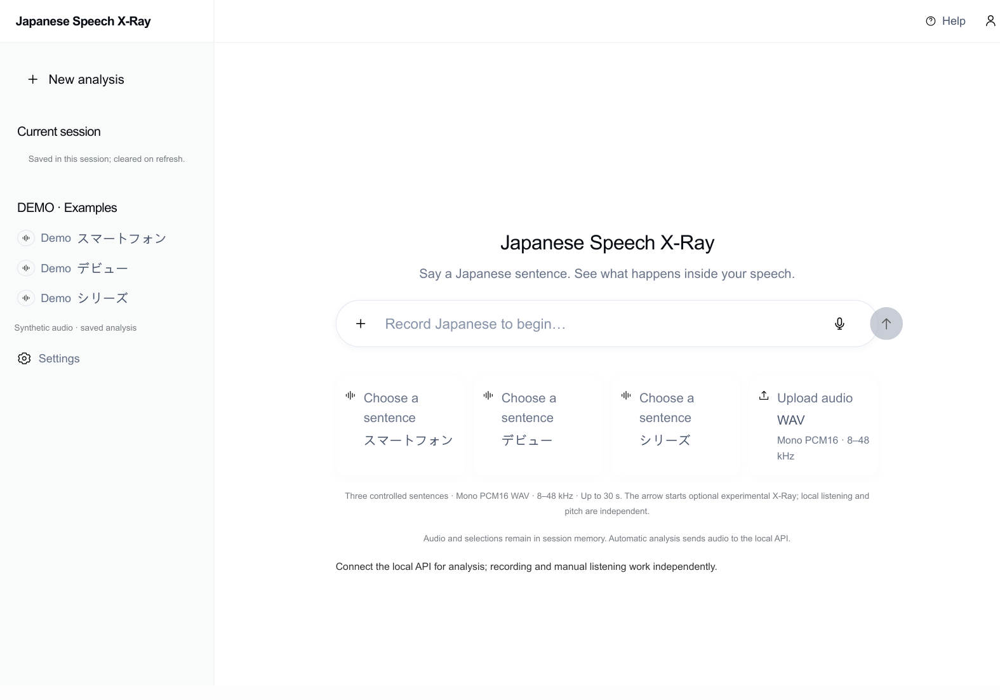
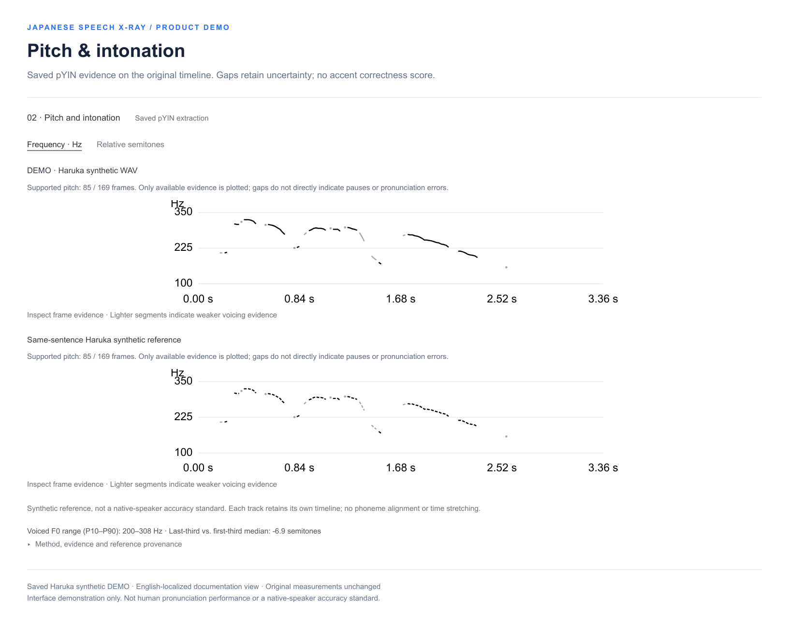
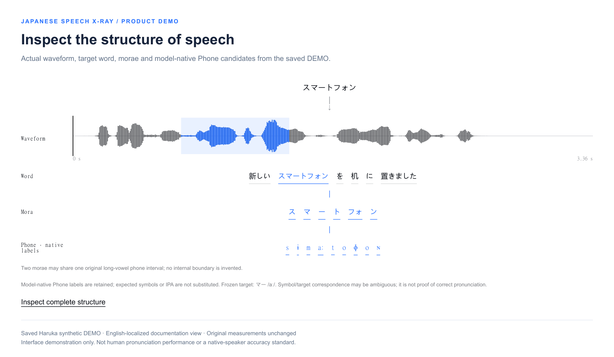
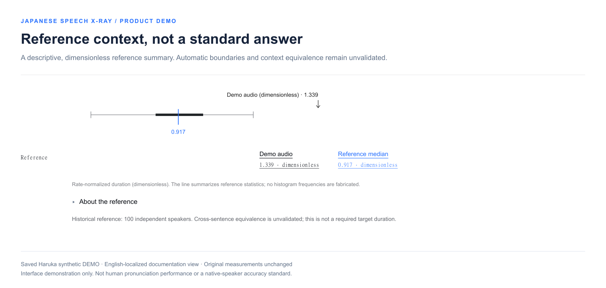
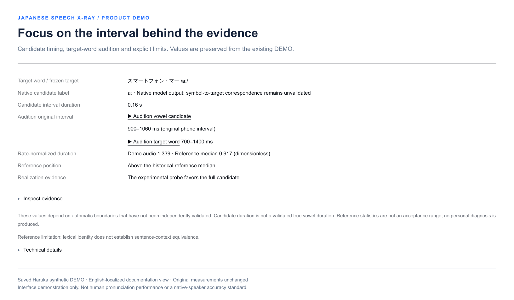

[English](README.md) | [简体中文](README.zh-CN.md)

# Japanese Speech X-Ray

**Make Japanese speech visible.**

An evidence-aware pronunciation visualization toolkit for inspecting original audio, pitch and intonation, speech structure, and descriptive reference comparisons. Built around three controlled Japanese practice sentences, with explicit uncertainty instead of uncalibrated pronunciation scores.

**Python · FastAPI · librosa / pYIN · MFA integration · React / TypeScript product interface**

## System architecture


The browser handles capture, waveform inspection, playback and session state. FastAPI exposes an **independent prosody service** and a separate **experimental X-Ray pipeline**. Optional speech resources and offline research are kept outside the default execution path.

[Architecture details and editable Mermaid](docs/ARCHITECTURE.md)

## End-to-end processing


- **Local practice:** inspect the actual waveform, select regions and listen repeatedly without waiting for automatic alignment.
- **Pitch and intonation:** extract F0 from the original PCM rate; retain only supported voiced frames and leave unreliable regions blank.
- **Experimental X-Ray:** use resource-validated MFA alignment, temporal structure mapping and descriptive acoustic/reference evidence. Automatic boundaries are candidates, not ground truth.

[Processing details and editable Mermaid](docs/PROCESSING-FLOW.md)

## Product showcase

The following panels are English-localized documentation captures of the actual product components, rendered with the existing saved DEMO. Numeric results and time coordinates are unchanged. Japanese utterances and model-native phone symbols are intentionally preserved.

The DEMO uses **Microsoft Haruka Desktop synthetic speech**, not a human learner recording. Its input and same-sentence reference use the **same synthetic WAV**: matching contours demonstrate the interface, not pronunciation accuracy. The React implementation and reviewed saved synthetic-DEMO response files are included. Haruka WAVs, model resources and private research archives are not distributed.

### Practice workspace (Page 1)



The actual workspace component brings recording, WAV upload, session navigation and the three practice sentences into one view. This English-localized documentation render shows its empty state; no recording or analysis result is fabricated. The live product interface uses Chinese labels. Original audio and manual practice remain available when automatic analysis is unavailable.

### Pitch and intonation



Real pYIN F0 estimates are plotted on each recording's original time axis. Gaps remain visible where voicing or energy evidence is insufficient; lower-confidence voiced segments are shown more lightly. The product also supports a relative-semitone view using each track's own voiced-F0 median as its baseline. There is no phoneme time alignment, time stretching, Tokyo-accent classification or personal correctness score in this module.

### Speech structure



Inspect a target word against its actual waveform and experimental Word / Mora / Phone layers. The view preserves model-native phone labels and original intervals. A long-vowel interval may be shared by two morae; the interface does not invent an internal boundary or replace an inconvenient model output with the expected target symbol.

### Native-speaker reference context



This research-oriented panel places a rate-normalized candidate duration alongside a historical JVS reference summary. The displayed values are **dimensionless**, not seconds or scores. The line and interquartile segment summarize available statistics; no histogram frequencies are fabricated. Cross-sentence equivalence and automatic target boundaries have not been independently validated, so the reference median is not a pronunciation pass/fail threshold. Only the displayed static summary is included; speaker-level records and the reference corpus remain excluded.

### Focused evidence and audition



Review the candidate interval, target-word audition range, normalization result and experimental realization evidence in one place. Playback is tied to the underlying audio interval rather than a schematic replacement. The system separates measured values, model candidates and unavailable evidence; it does not turn an experimental candidate comparison into a clinical or educational diagnosis.

Static captures document the interface. A frontend-only preview is available at [liguozheng.com.cn](https://liguozheng.com.cn/); it does not deploy the analysis backend. [Capture provenance and display scope](docs/SCREENSHOT-REVIEW.md).

## Engineering capabilities

- Strict **Mono PCM16 RIFF WAV** admission: 8–48 kHz, up to 30 seconds and 10 MiB by default. Unsupported uploads are rejected without silent downmixing or resampling.
- Original-rate **F0, timestamps, voicing evidence and RMS** through librosa pYIN, with explicit `AVAILABLE` / `ABSTAINED` outcomes.
- An independent prosody endpoint that does not require MFA or Narabas boundaries; missing synthetic references do not discard the input track.
- Controlled prompt identities, resource hashes, typed evidence responses and request correlation IDs.
- Bounded experimental execution, real stage polling, process-tree cancellation and temporary-workspace cleanup.
- MFA integration, TextGrid parsing, Japanese mora mapping, acoustic evidence methods and offline evaluation tools.

The source checkout directly supports WAV validation, prompt discovery, engineering-signal F0 extraction and tests. Full experimental alignment and reference comparison require separately obtained, compatible resources. Narabas adapters remain research-only and are not activated by default.

## Quick start

Verified environment: **Windows x64 / Python 3.13.15**. Install and initialize Conda from an [official distribution](https://github.com/conda-forge/miniforge) first. From the repository root, run PowerShell:

```powershell
conda create --prefix ./.venv --file environment-public-win-64.explicit.txt
conda activate "$PWD/.venv"
python -m pip install -r requirements.txt
python -m pip install -e . --no-deps
python -m pip check
python scripts/run_tests.py
python examples/prosody_smoke.py
python -m uvicorn speech_xray.api.app:app --host 127.0.0.1 --port 8000
```

These commands start the local API. Start the included browser application in a second terminal using the frontend commands below. Activate the environment on Windows so SoundFile can resolve `libsndfile.dll`. The explicit environment lock targets `win-64`; other platforms have not been verified. The wheel contains Python modules, not all runtime configuration or product assets, so normal reproduction uses the source checkout.

[Reproduction guide and API examples](docs/REPRODUCIBILITY.md) · [Optional alignment/reference resources](docs/OPTIONAL-RESOURCES.md)

### Start the browser interface

In a second terminal, with Node.js >=22.12.0 installed:

```powershell
cd frontend
npm ci
npm test
npm run build
npm run dev
```

Open [Page 0](http://127.0.0.1:5173/) or the [Page 1 workspace](http://127.0.0.1:5173/#/workspace). Vite proxies `/api` to the local API on port 8000. The source builds without private media; Haruka playback and saved audio-backed DEMOs need separately authorized exact WAVs. Four exact-audio tests explicitly skip without them. [Frontend guide](frontend/README.md).

## Verification

| Scope | Result | Evidence status |
| --- | --- | --- |
| Accepted local V1 frontend | 95 / 95 | Historical V1 receipt; not a fresh whole-product test run |
| Accepted local V1 backend | 565 / 565 | Historical V1 receipt; separate from the public checkout |
| Public backend, Phase B | 548 total: 543 passed, 5 skipped, 0 failures/errors | Actually rerun on 2026-10-10 |
| Public API engineering checks | 9 / 9 | Real TCP service, no injected analysis stub |

The five skips require excluded JVS / Haruka resources. Tests cover engineering signals, authored structural fixtures and adapter behavior; they do not certify human acoustic accuracy. This documentation update does not present historical receipts as newly executed tests.

The public API was verified to retain input F0 when a synthetic reference is absent, abstain on silence, reject invalid input, and report missing experimental resources explicitly. [Detailed receipts](docs/VERIFICATION.md).

## Scope and limitations

- Three controlled practice sentences; no unrestricted ASR or open-ended pronunciation diagnosis.
- F0 estimates can be sparse or incorrect; blank regions are not automatically pauses or pronunciation errors.
- Synthetic references are not native-speaker accuracy standards. No calibrated personal score or accent pass/fail claim.
- MFA analysis can take minutes on the verified local CPU environment. Automatic boundaries and historical reference statistics retain research limitations.
- This repository provides the Python analysis implementation, React frontend, tests and engineering tools. Optional audio, pretrained models and private research records are not included.
- A **frontend-only preview** is available at [liguozheng.com.cn](https://liguozheng.com.cn/). Online automatic analysis is not deployed; public authentication, global rate limiting and multi-user isolation have not been accepted for production.

[Known limitations](docs/KNOWN-LIMITATIONS.md) · [Engineering decisions](docs/TECHNICAL-DECISIONS.md)

## License and provenance

The standard [MIT License](LICENSE) applies to the author-owned **Python and frontend source files** explicitly listed in [LICENSE-SCOPE.md](LICENSE-SCOPE.md). Documentation, screenshots, diagrams, branding and third-party resources do not inherit that code license. Displayed figures are included for repository presentation with rights retained.

The implementation was exported into an independent Git history from the accepted local `v1.0.0-local` snapshot. The original product history and tag were not imported. Third-party packages, speech resources and models retain their own license terms.

[Third-party sources](THIRD_PARTY.md) · [Publication scope](docs/PUBLIC-RELEASE-SCOPE.md) · [File manifest](TASK-021-PUBLIC-FILE-MANIFEST.md)

The frontend was added on 2026-10-28 from local product commit `68effe8dc04e1cf10579c0ac2143288fa4f24eef`. Original private history was not imported, and this source publication does not modify the deployed website.
