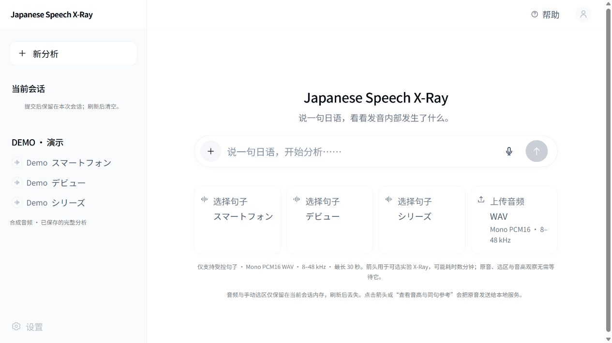

# Japanese Speech X-Ray — Partially Open-Source Backend

把日语练习中的声音变成可观察的证据：原音、波形、音高、有声片段，以及独立标注为实验功能的自动对齐。

本仓库公开 Japanese Speech X-Ray 的自有 Python 后端、语音分析实现与相关工程资料。完整 React 前端、交互界面源码及原创视觉素材不在公开范围内。

**部分开源：** 经审核的 198 份自有 Python 后端、测试、工具与示例代码采用 [MIT](LICENSE)，以 [LICENSE-SCOPE.md](LICENSE-SCOPE.md) 的逐文件清单为准。截图、项目文档、品牌与第三方资源不因此取得 MIT 授权。

## 产品预览



截图来自实际本地产品，显示空会话；完整交互界面采用私有前端实现，不在本公开仓库提供。截图不含私人录音、第三方音频曲线或动态背景画面。来源见 [截图审核](docs/SCREENSHOT-REVIEW.md)。

## 已提供的工程能力

- 严格的 Mono PCM16 RIFF WAV 准入：8–48 kHz、最长 30 秒；拒绝 MP3、立体声和超限输入，不静默转换。
- librosa pYIN 真实 F0、原始时间戳、有声标记、概率证据及 RMS；缺少证据时明确弃权。
- FastAPI 音高接口可独立运行，不要求 MFA／Narabas 音素边界。
- 三条受控练习句目录、请求边界、资源哈希校验、关联 ID、实验分析进度及取消控制。
- 自有 MFA 集成、TextGrid 解析、日语音拍映射、声学证据、参考统计与离线实验工具。
- 作者编写的测试与结构示例；没有打包真人语料、模型或合成参考 WAV。

**直接可运行：** WAV 验证、真实 pYIN 工程信号、API 句子目录、单元测试。

**需外部资源：** 实验对齐和母语者参考比较。默认返回不可用，不生成虚假的完整 X-Ray。Narabas 适配源码保留作研究记录，默认未启用，权重及研究数据不提供。

## 快速复现

验证平台：Windows x64、Python 3.13.15。需先从 [官方渠道](https://github.com/conda-forge/miniforge) 安装并初始化 Conda；本仓库不附带环境二进制。

在仓库根目录执行 PowerShell：

```powershell
conda create --prefix ./.venv --file environment-public-win-64.explicit.txt
conda activate "$PWD/.venv"
python -m pip install -r requirements.txt
python -m pip install -e . --no-deps
python -m pip check
python scripts/run_tests.py
python examples/prosody_smoke.py
python -m uvicorn speech_xray.api.app:app --host 127.0.0.1 --port 8000
```

这段命令启动本地 API，不启动完整网页。Windows 必须激活环境，使 SoundFile 能找到 libsndfile DLL。环境 URL 锁属于 win-64；其他平台未验证。

无需对齐资源的 API 示例及可自行生成的非语音输入见 [复现说明](docs/REPRODUCIBILITY.md)。实验对齐配置见 [可选资源](docs/OPTIONAL-RESOURCES.md)。

## 架构与工程决策

[架构](docs/ARCHITECTURE.md) 区分私有产品层、公开后端、未激活研究组件。

[工程决策](docs/TECHNICAL-DECISIONS.md) 记录证据门禁、资源隔离和公开候选适配。

音高曲线只绘制实际可用帧，空白不直接代表停顿或发音错误。自动音素候选不等于真实边界；合成参考不是母语者准确性标准。本项目不提供未经校准的个人正确率、重音合格判断或综合分数。

## 验证与限制

Phase A 独立候选历史测试：**548 项，543 通过，0 失败，0 错误，5 跳过**。5 项涉及未提供的 JVS／Haruka 音频。测试采用工程信号、作者结构夹具及必要的模拟适配器，不代表真人声学准确率认证。

Phase B 发布前于 2026-10-10 实际重跑：**548 项，543 通过，5 跳过，0 失败，0 错误**；后端安装、依赖检查、wheel 构建和 9 项真实 TCP 检查通过。未修改语音算法，也未将历史测试冒充本轮结果。

原完整 V1.0 历史收据：前端 95/95、后端 565/565，类型检查与构建通过；与公开后端测试分开统计。真实 TCP 服务、pYIN、静音弃权与非法音频拒绝已验证，详情见 [验证收据](docs/VERIFICATION.md)。

真人 F0 仍可能稀疏；音高重音正确性未校准；MFA 可能需要分钟级时间；长元音自动诊断和参考分布未独立验证。产品仅支持三条受控练习句，详见 [已知限制](docs/KNOWN-LIMITATIONS.md)。

## 在线演示

在线交互演示正在准备中，后续将提供独立部署网址。网页前端源码与原创视觉素材不包含在本公开仓库中。

## 来源、许可与范围

后端快照基线：本地已验收标签 `v1.0.0-local`，Commit `9809309ea68855c814eb22bd21784889d0ff1df6`。公开仓库创建独立历史，没有继承完整产品的 Git 对象；Phase A 审查提交为 `dd064bc799e074e54bc0a899f5db814fbed0ab80`。

自有代码的正式许可为 **MIT_LIMITED_SCOPE**：[MIT 全文](LICENSE) 与 [逐文件授权范围](LICENSE-SCOPE.md)。本仓库没有公开完整产品源码；第三方依赖继续适用其自身许可证。

[第三方来源与许可](THIRD_PARTY.md) · [公开范围](docs/PUBLIC-RELEASE-SCOPE.md) · [完整文件清单](TASK-021-PUBLIC-FILE-MANIFEST.md)
