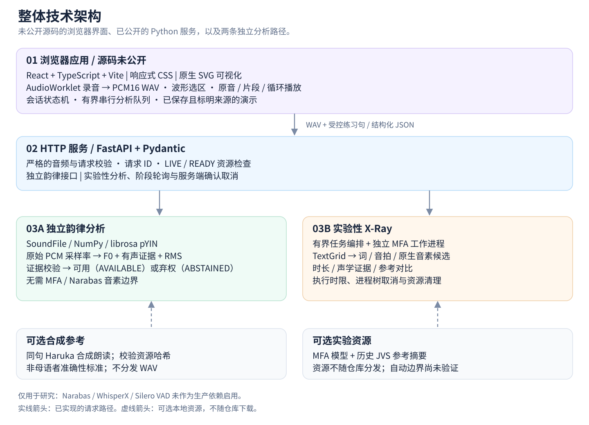
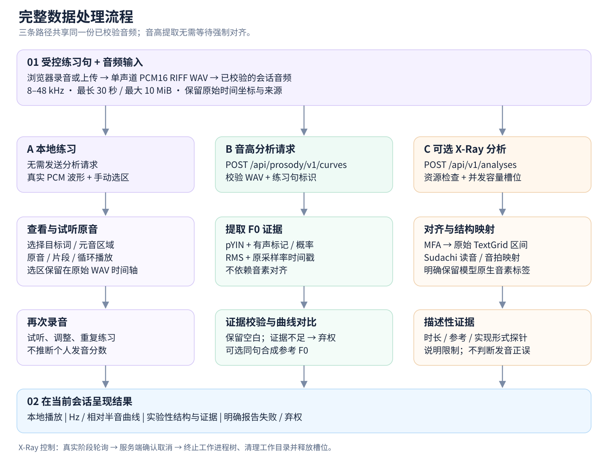
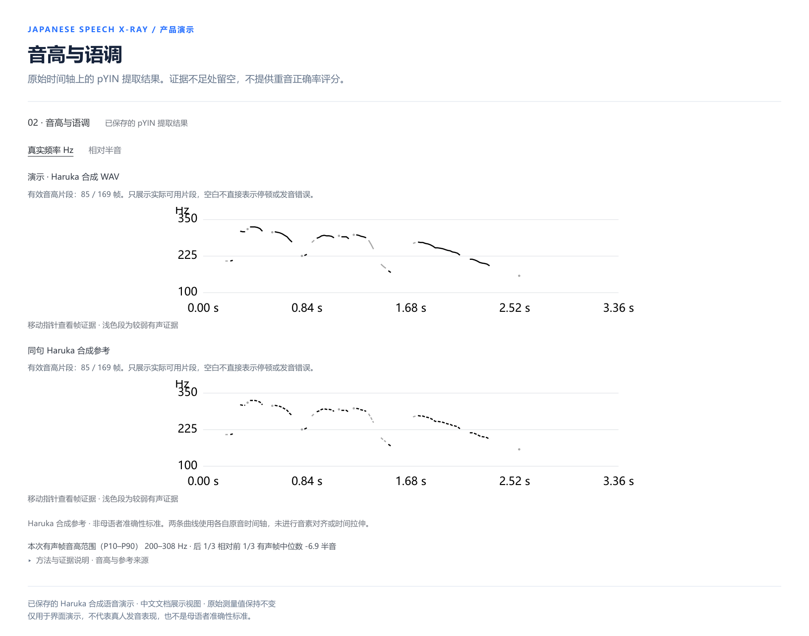
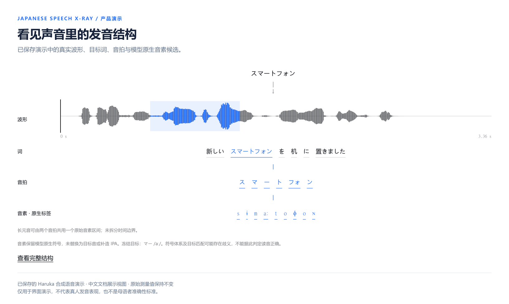
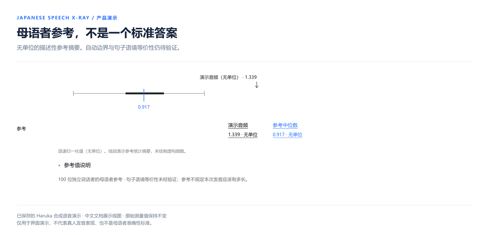
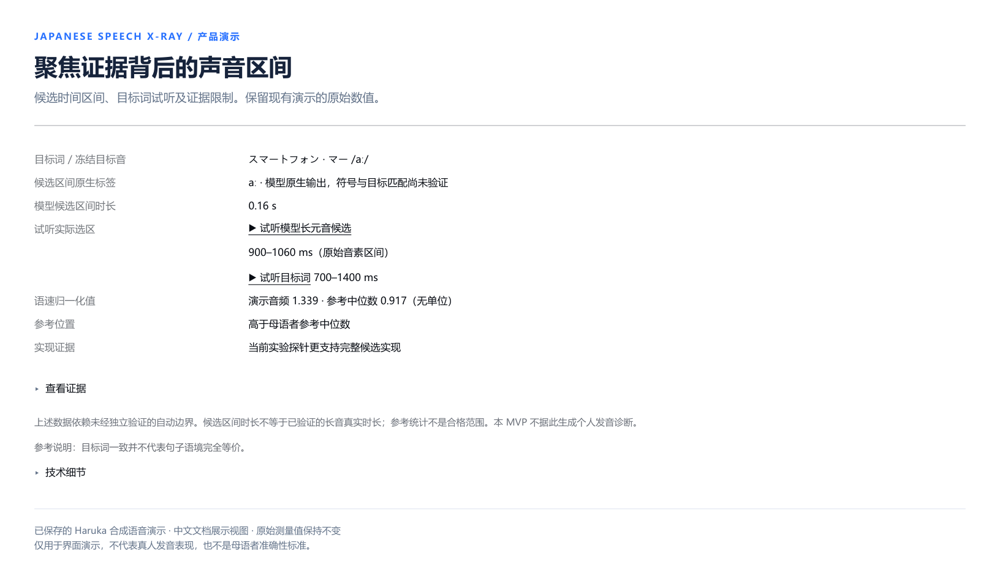

[English](README.md) | [简体中文](README.zh-CN.md)

# Japanese Speech X-Ray

**让日语发音变得可见。**

一个明确呈现证据与不确定性的发音可视化工具，用于观察原始音频、音高与语调、发音结构及描述性参考对比。围绕三条受控日语练习句构建，明确说明证据限制，不提供未经校准的发音评分。

**Python · FastAPI · librosa / pYIN · MFA 集成 · React / TypeScript 产品界面**

## 系统架构



浏览器负责录音、波形查看、音频播放和会话状态管理。FastAPI 提供**独立的韵律分析服务**与单独的**实验性 X-Ray 分析流程**。可选语音资源及离线研究不属于默认执行路径。

[架构说明与可编辑的 Mermaid 图](docs/ARCHITECTURE.md)

## 完整数据处理流程



- **本地练习：**查看真实波形、选择区域并反复试听，无需等待自动对齐。
- **音高与语调：**按原始 PCM 采样率提取 F0；仅保留有证据支持的有声帧，不可靠区域留空。
- **实验性 X-Ray：**在资源校验通过后执行 MFA 对齐、时间结构映射及描述性声学与参考证据分析。自动边界属于候选结果，不是真实边界标注。

[处理流程说明与可编辑的 Mermaid 图](docs/PROCESSING-FLOW.md)

## 产品展示

以下面板由实际产品组件加载现有的已保存 DEMO 渲染而成，并为本中文版文档使用中文界面文字。数值结果与时间坐标保持原样；日语句子和模型原生音素符号予以保留。

DEMO 使用 **Microsoft Haruka Desktop 合成语音**，并非真人学习者录音。输入与同句参考使用的是**同一份合成 WAV**：曲线重合用于展示界面能力，不代表发音准确性。音频、私有分析 JSON 和前端实现不在本仓库的分发范围内。

### 音高与语调



将真实的 pYIN F0 估计绘制在各段录音的原始时间轴上。有声或能量证据不足的位置保留空白；可信度较低的有声片段以浅色显示。产品还支持相对半音视图，以各条音轨自身的有声 F0 中位数作为基线。本模块不进行音素时间对齐、时间拉伸、东京式重音分类或个人正确率评分。

### 发音结构



结合真实波形与实验性的 Word / Mora / Phone 层观察目标词。界面保留模型原生音素标签和原始区间。一个长元音区间可能由两个音拍共享；界面不会人为添加内部边界，也不会将不符合预期的模型输出替换为目标音素符号。

### 母语者参考



这一研究性面板将语速归一化后的候选区间时长与历史 JVS 参考统计摘要并列展示。所示数值**无单位**，不是秒数或分数。线段及四分位区间用于概括已有统计，不虚构直方图频数。跨句语境等价性和自动目标边界尚未经过独立验证，因此参考中位数不是发音合格与否的阈值。仓库仅包含展示用的静态摘要，不包含逐说话者记录或参考语料库。

### 聚焦证据与试听



集中查看候选区间、目标词试听范围、归一化结果及实验性实现形式证据。播放对应底层音频的实际区间，不使用示意音频替代。系统区分实测数值、模型候选和不可用证据，不将实验性候选对比转化为临床或教学诊断。

静态截图展示产品界面，并非在线服务。[截图来源与展示范围](docs/SCREENSHOT-REVIEW.md)。

## 工程能力

- 严格校验 **Mono PCM16 RIFF WAV**：8–48 kHz，默认最长 30 秒、最大 10 MiB。不支持的上传会被拒绝，不静默混为单声道或重采样。
- 通过 librosa pYIN 按原始采样率提取 **F0、时间戳、有声证据和 RMS**，明确返回 `AVAILABLE` / `ABSTAINED` 状态。
- 独立韵律分析端点无需 MFA 或 Narabas 边界；合成参考缺失时仍保留输入音轨的分析结果。
- 受控练习句标识、资源哈希、类型化证据响应及请求关联 ID。
- 实验任务执行有界，支持真实阶段轮询、进程树取消及临时工作目录清理。
- MFA 集成、TextGrid 解析、日语音拍映射、声学证据方法与离线评估工具。

源码检出后可直接运行 WAV 校验、练习句查询、工程信号 F0 提取和测试。完整的实验性对齐与参考对比需要另行获取兼容资源。Narabas 适配器仅用于研究，默认不启用。

## 快速开始

已验证环境：**Windows x64 / Python 3.13.15**。请先通过[官方发行版](https://github.com/conda-forge/miniforge)安装并初始化 Conda。在仓库根目录打开 PowerShell，执行：

```powershell
conda create --prefix ./.venv --file environment-public-win-64.explicit.txt
conda activate "$PWD/.venv"
python -m pip install -r requirements.txt
python -m pip install -e . --no-deps
python -m pip check
python scripts/run_tests.py
python examples/prosody_smoke.py
python -m uvicorn speech_xray.api.app:app --host 127.0.0.1 --port 8000
```

这些命令启动本地 API，不启动未公开的浏览器应用。在 Windows 中需激活环境，以便 SoundFile 找到 `libsndfile.dll`。显式环境锁定文件面向 `win-64`，其他平台尚未验证。wheel 包包含 Python 模块，并不包含全部运行配置或产品素材，因此常规复现应使用源码检出目录。

[复现指南与 API 示例](docs/REPRODUCIBILITY.md) · [可选对齐与参考资源](docs/OPTIONAL-RESOURCES.md)

## 验证记录

| 范围 | 结果 | 证据状态 |
| --- | --- | --- |
| 已验收的本地 V1 前端 | 95 / 95 | 历史 V1 收据，并非本次重新执行的完整产品测试 |
| 已验收的本地 V1 后端 | 565 / 565 | 历史 V1 收据，与公开源码检出目录的测试分开记录 |
| 公开后端，Phase B | 共 548 项：543 通过、5 跳过、0 失败或错误 | 于 2026-10-10 实际重新执行 |
| 公开 API 工程检查 | 9 / 9 | 真实 TCP 服务，未注入分析桩 |

跳过的 5 项需要未包含在仓库中的 JVS / Haruka 资源。测试覆盖工程信号、自有结构测试数据及适配器行为，不构成真人声学准确性认证。本次文档更新不将历史收据表述为新执行的测试。

公开 API 已验证以下行为：合成参考缺失时保留输入 F0、对静音弃权、拒绝非法输入，并明确报告实验资源缺失。[详细验证收据](docs/VERIFICATION.md)。

## 范围与限制

- 仅支持三条受控练习句，不提供不受限的 ASR 或开放式发音诊断。
- F0 估计可能稀疏或出错；空白区域不自动等于停顿或发音错误。
- 合成参考不是母语者准确性标准。不提供经过校准的个人评分或重音合格判断。
- 在已验证的本地 CPU 环境中，MFA 分析可能耗时数分钟。自动边界和历史参考统计仍具有研究限制。
- 本仓库提供 Python 分析实现、测试和工程工具，不包含 React 产品源码、音频、预训练模型或私有研究记录。
- **目前未部署托管的交互式 DEMO。**面向公网的身份验证、全局限流及多用户隔离尚未通过生产验收。

[已知限制](docs/KNOWN-LIMITATIONS.md) · [工程决策](docs/TECHNICAL-DECISIONS.md)

## 许可证与来源

标准 [MIT 许可证](LICENSE)仅适用于 [LICENSE-SCOPE.md](LICENSE-SCOPE.md) 明确列出的 **198 份作者自有 Python 文件**。文档、截图、架构图、品牌及第三方资源不沿用该代码许可证。展示图仅用于仓库介绍，相关权利予以保留。

实现代码从已验收的本地 `v1.0.0-local` 快照导出，并建立了独立的 Git 历史；原产品历史及标签未导入。第三方软件包、语音资源和模型仍适用各自的许可条款。

[第三方来源](THIRD_PARTY.md) · [公开范围](docs/PUBLIC-RELEASE-SCOPE.md) · [文件清单](TASK-021-PUBLIC-FILE-MANIFEST.md)
