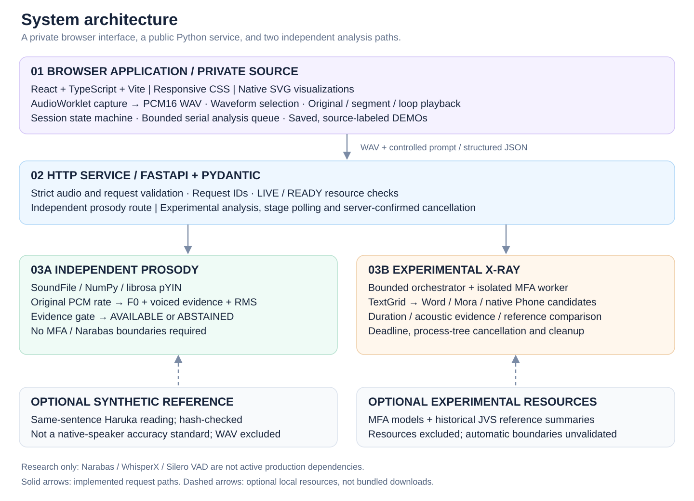
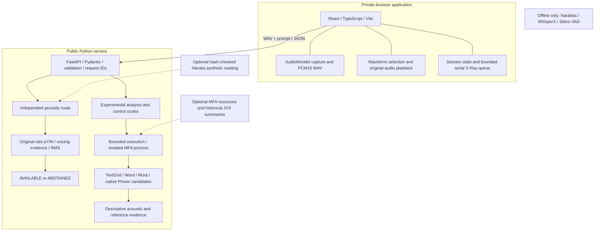

# System architecture

The diagram describes implemented local product responsibilities, not a proposed cloud deployment. The React interface is private; this repository contains the Python implementation and selected presentation assets. Components inside an analysis path are modules, not separately deployed microservices.

## Editable Mermaid

Prosody is independent of experimental alignment readiness and its queue. An unavailable reference produces a null reference with an explicit reason while the input F0 can remain available. Research nodes have no production execution edge. Reference audio, model resources and private reference records are not bundled.

| Source area | Responsibility | External resources |
| --- | --- | --- |
| api / product/audio / product/prompts | HTTP contract, WAV admission, three controlled prompts | None for basic validation and discovery |
| prosody | Frozen pYIN extraction, evidence gates, reference fallback | Input F0 needs no large model; reference needs a compatible authorized WAV |
| product/runtime / pipeline / orchestrator | MFA integration, capacity, stages, cancellation and cleanup | MFA runtime, models and reference configuration |
| alignment / japanese / acoustics | Temporal structure, mora mapping and acoustic evidence | Some offline tools consume pre-existing alignments |
| reference / deviation / realization | Resource/domain checks, descriptive statistics and candidates | Compatible reference data for actual comparison |
| corpus / evaluation / stress / realization_benchmark | Offline research and engineering evaluation | Separately obtained data or tools; not bundled |
| product/narabas_* | Historical research adapters | Not activated by default; weights and private configuration excluded |

LIVE confirms service liveness. Experimental READY is a resource/readiness check, not a guarantee of calibrated linguistic accuracy. See [processing flow](PROCESSING-FLOW.md) and [limitations](KNOWN-LIMITATIONS.md).
