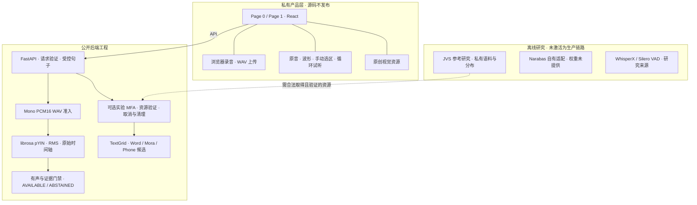

# 技术架构

公开候选保持冻结 V1 后端的计算公式和 pYIN 参数。私有网页通过 API 调用后端，但不属于本候选源码。

音高接口独立于实验分析队列与对齐 readiness。缺少参考 WAV 不阻断用户音高；参考字段为空，并返回明确 reason。图中的研究组件不表示默认产品依赖，也不表示存在公开模型服务。

| 源码区域 | 职责 | 默认是否需要外部资源 |
| --- | --- | --- |
| api / product/audio / product/prompts | HTTP 契约、WAV 验证、三条受控句子 | 无 |
| prosody | 冻结 pYIN 实现、内存处理、合成参考缺失弃权 | F0 无；参考需要另行授权的 WAV |
| product/runtime / pipeline / orchestrator | 自有 MFA 接入、容量、进度、取消、清理 | MFA 运行时、模型、参考配置 |
| alignment / japanese / acoustics | 时间结构、音拍及声学证据 | 部分离线工具需要既有对齐输入 |
| reference / deviation / realization | 哈希和域检查、统计及候选证据 | 真实比较需要合法的参考数据 |
| corpus / external_jvs / jvs_reference / evaluation / stress / realization_benchmark | 作者编写的离线研究工具与方法 | 真实语料／人工标签／外部工具，均未附带 |
| product/narabas_* | 历史自有适配器，保留审查线索 | 默认不启用；源码、权重、冻结序列及接受配置不提供 |

没有公开模型权重、300 条参考记录、私人时间戳或前端录音实现。API 生存状态 LIVE 不等于实验对齐 READY。
