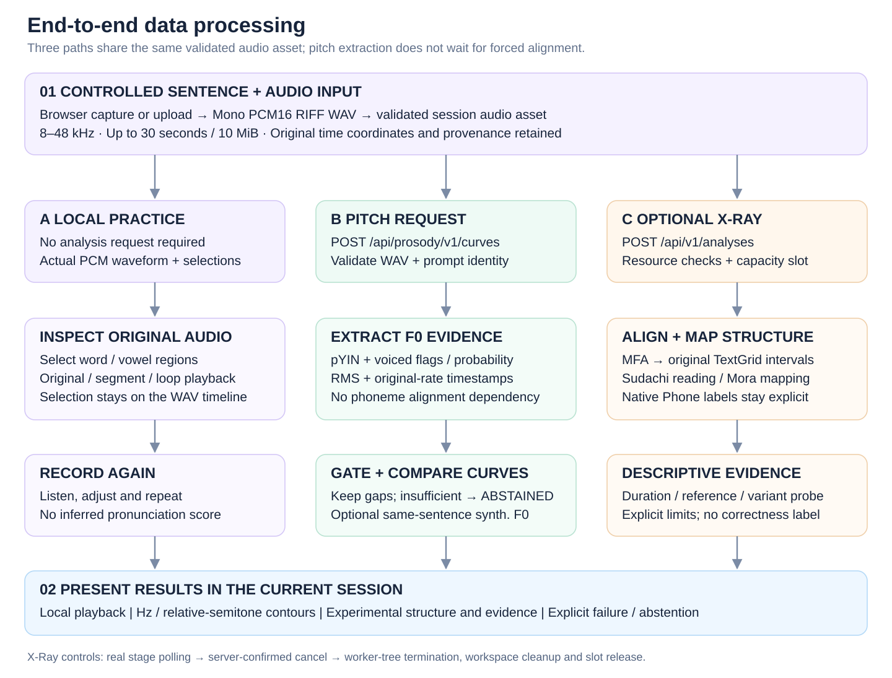
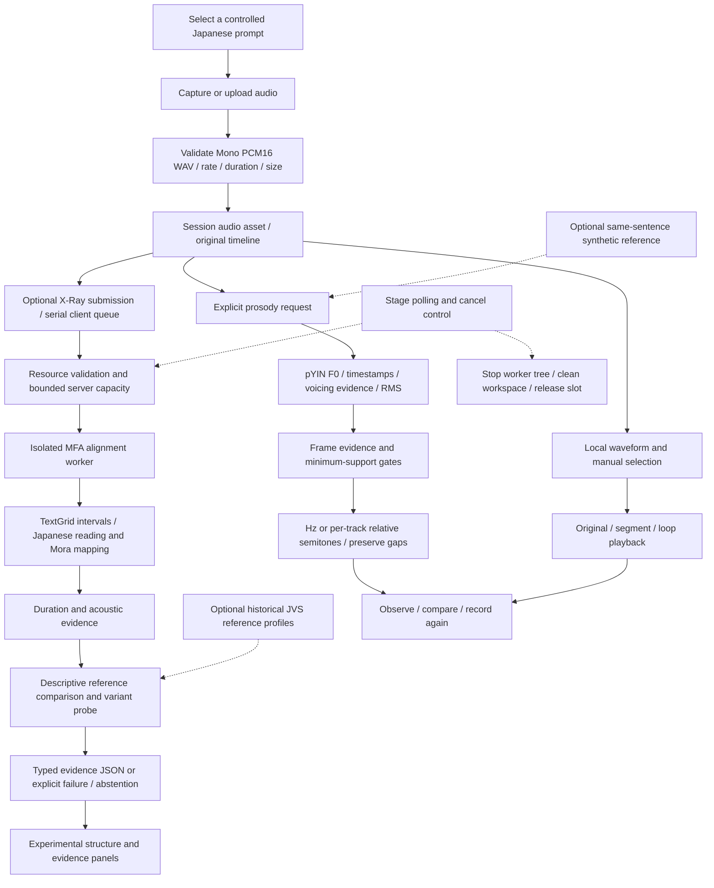

# End-to-end processing

## Editable Mermaid

## Input and time coordinates

Uploads preserve the accepted WAV bytes: no silent downmixing, resampling or fabricated header rates. Browser capture separately documents actual input channels and AudioContext processing rate; a supported stereo microphone input is explicitly averaged to mono and recorded as provenance. The upload path does not perform that conversion.

Local selection and playback remain on the original WAV timeline. F0 uses its own original-rate timestamps; synthetic and input tracks are not phoneme-aligned or time-stretched. Experimental Word / Mora / Phone intervals retain their candidate status.

## Request and cancellation semantics

The experimental analysis endpoint waits for one bounded calculation; it is not a durable distributed job queue. The browser polls real runtime stages. A cancel request uses the same per-analysis control token; CANCELLED is acknowledged only after worker termination, workspace cleanup and capacity release. Aborting a browser fetch alone is not proof that server-side computation stopped.

The independent prosody endpoint has a separate capacity lock. Its client-side abort does not promise immediate cancellation of an in-progress pYIN calculation. Missing references, insufficient voiced evidence, transport failure and experimental resource errors remain distinct outcomes.

## Data retention

The browser keeps session assets in memory and releases Object URLs. Prosody decodes the submitted WAV in memory and caches only the fixed synthetic reference, not learner audio; HTTP multipart spooling may still use an operating-system temporary file. Experimental analysis uses a random request workspace with cleanup by default; explicit debug retention changes that behavior. Public multi-user security has not been accepted for production.
